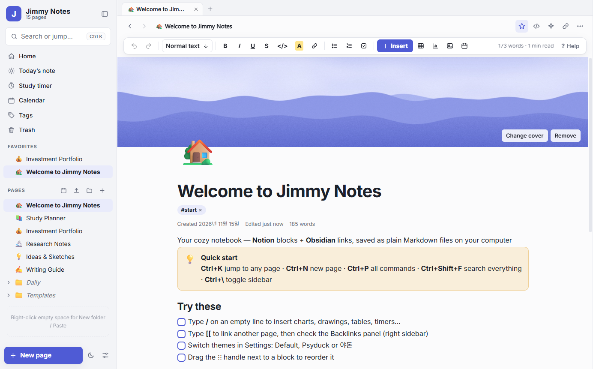
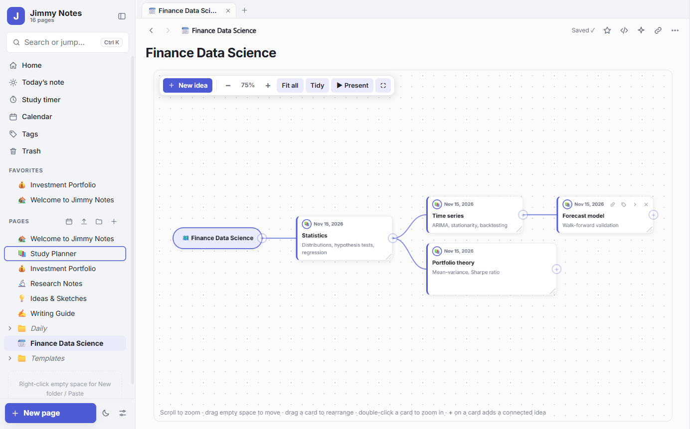
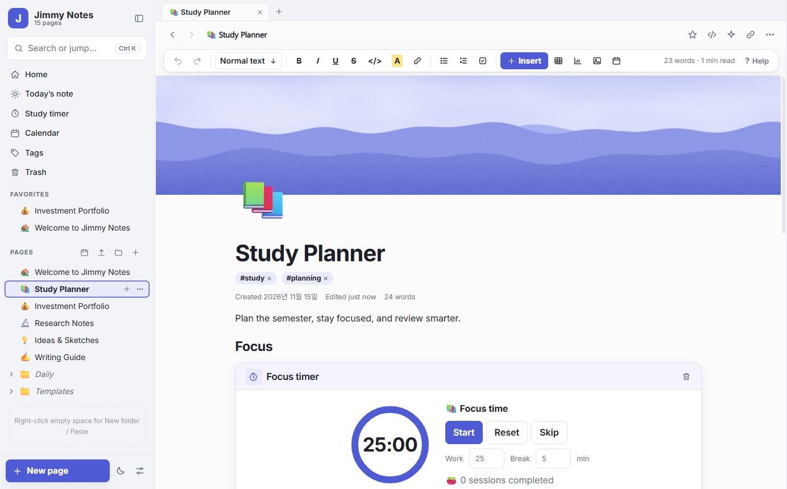
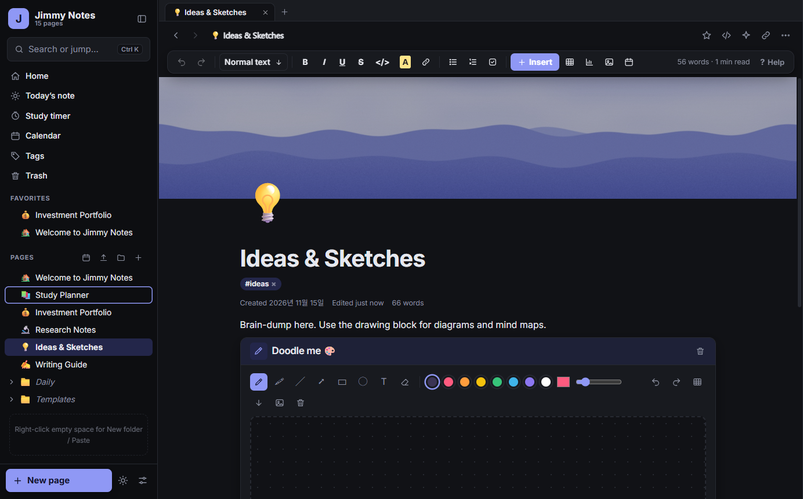

<div align="center">


# Jimmy Notes

**A cozy Notion + Obsidian style notebook. Blocks, `[[links]]`, and every page saved as a plain Markdown file on your computer.**

Built with Electron · No account · No cloud · Your notes stay yours

</div>

<p align="center">
  
</p>

## Features

- **Block editor**: type `/` for headings, checklists, tables, charts, drawings, databases, timers and more. Drag the handle to reorder blocks.
- **Markdown vault**: pages are normal `.md` files in a folder you choose, so they open in any editor and work with Git or Dropbox.
- **Obsidian-style linking**: `[[page links]]`, a backlinks panel, tags, favorites, tabs and a Ctrl+K quick switcher.
- **Timeline mind-maps**: a zoomable tree canvas where every idea is a card. Drag to rearrange, scroll to zoom, **drag the corner grip to resize any card**, and present it like slides.
- **Study tools**: study timer, calendar, daily notes and flashcards.
- **Finance blocks**: portfolio tracker, stock and market widgets, and charts.
- **Sketch pad**: pen, highlighter, shapes and text, with export to an image.
- **Math and code**: KaTeX equations and syntax-highlighted code.
- **AI assistant** (optional): summarize and ask questions about a page, and import PDFs.
- **Themes**: light and dark mode, accent colors, fonts and page covers.

## Screenshots

### Timeline canvas
Cards can be resized individually. Double-click the grip to reset a card.

<p align="center"></p>

### Study planner
<p align="center"></p>

### Research notes
<p align="center"></p>

### Dark mode and sketches
<p align="center"></p>

## Getting started

Requires [Node.js](https://nodejs.org) 18 or newer.

```bash
git clone https://github.com/thswlsgud0423/JimmyNotebook.git
cd JimmyNotebook
npm install
npm start
```

On first launch the app creates a vault at `Documents/Jimmy Notes` with a few sample pages. You can change the folder in Settings.

### Build a Windows app

```bash
npm run pack        # creates dist/Jimmy Notes-win32-x64
```

### Tests

```bash
npm test            # Markdown parser tests
npm run e2e         # drives the real app and checks the UI
```

## Keyboard shortcuts

| Keys | Action |
|---|---|
| `Ctrl+K` | Jump to any page |
| `Ctrl+N` | New page |
| `Ctrl+P` | Command palette |
| `Ctrl+Shift+F` | Search everything |
| `Ctrl+\` | Toggle sidebar |
| `/` | Insert a block |

## License

MIT
